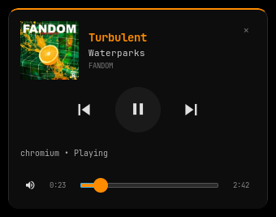

# waybar-player

A compact MPRIS player for Waybar: a JSON status module and a GTK3 +
gtk-layer-shell popup.



English popup; the Russian popup is shown in the Russian section below.

## Features

- Animated disc `◐ ◓ ◑ ◒`, marquee title, pause/idle states and a detailed
  tooltip (title, artist, album, player, volume).
- JSON output for Waybar: `text`, `tooltip`, `class` and `percentage`.
- Popup under the player area: cover, title, artist, album, prev/play/next,
  volume slider and seek bar.
- Closes on outside click, `✕`, `Esc`, a second click on the module, or a niri
  workspace change.
- Asynchronous cover loading with a placeholder; covers are cached for 14 days.
- English and Russian UI, plus a JSON-based way to add more languages.

## Requirements (Arch)

Required:

```text
bash waybar playerctl python python-gobject gtk3 gtk-layer-shell
gdk-pixbuf2 pango util-linux procps-ng coreutils
```

Optional:

```text
niri                    # close the popup on workspace switch
ttf-jetbrains-mono-nerd # Nerd Font glyphs
libnotify               # error notifications
```

## Installation

### Get the code

```bash
git clone https://github.com/Albuka1/waybar-player
cd waybar-player
```

### User install, no sudo

```bash
./install.sh
# or: PREFIX="$HOME/.local" ./install.sh
```

Installed files:

```text
$PREFIX/bin/waybar-player-status
$PREFIX/bin/waybar-player-menu
$PREFIX/share/waybar-player/player-menu.py
$PREFIX/share/waybar-player/i18n.py
$PREFIX/share/waybar-player/locales/en.json
$PREFIX/share/waybar-player/locales/ru.json
$PREFIX/share/doc/waybar-player/
```

`waybar-player-menu` searches for `player-menu.py` in this order:

1. `../share/waybar-player/player-menu.py` (installed prefix);
2. next to the wrapper (old manual layout);
3. `../share/player-menu.py` (git checkout);
4. `/usr/share/waybar-player/player-menu.py` (system package).

Make sure `$PREFIX/bin` is in Waybar's `PATH`, or use absolute paths in the
Waybar config (for example `~/.local/bin/waybar-player-status`).

Uninstall the installed files (configuration and cache are untouched):

```bash
./uninstall.sh
# or: PREFIX=/another/prefix ./uninstall.sh
```

### Arch package

The PKGBUILD downloads the tagged release from GitHub:

```bash
mkdir /tmp/waybar-player-build && cd /tmp/waybar-player-build
curl -LO https://raw.githubusercontent.com/Albuka1/waybar-player/master/PKGBUILD
makepkg -si
```

## Waybar setup

Add `custom/player` to `modules-right` (or `modules-center`). Remove the
built-in `mpris` module if it is enabled, otherwise the track is shown twice.

```jsonc
"custom/player": {
  "exec": "waybar-player-status",
  "return-type": "json",
  "escape": true,
  "tooltip": true,
  "exec-on-event": false,
  "restart-interval": 2,
  "on-click": "waybar-player-menu",
  "on-click-middle": "playerctl previous",
  "on-click-right": "playerctl play-pause",
  "on-scroll-up": "playerctl volume 0.05+",
  "on-scroll-down": "playerctl volume 0.05-"
}
```

A minimal example is in [`examples/config.jsonc`](examples/config.jsonc).

Styles:

```css
#custom-player {
    color: #ff8c00;
    padding: 0 16px;
    margin: 0 8px;
    background-color: rgba(255, 140, 0, 0.08);
    border-radius: 6px;
}

#custom-player.paused {
    color: #666666;
    background-color: rgba(255, 255, 255, 0.045);
}

#custom-player.stopped {
    color: #555555;
    background-color: transparent;
}

#custom-player:hover {
    background-color: rgba(255, 140, 0, 0.18);
}
```

See [`examples/style.css`](examples/style.css).

## Environment

| Variable | Default | Purpose |
|---|---:|---|
| `WAYBAR_PLAYER_RIGHT_MARGIN` | `215` | Popup offset from the right screen edge. |
| `WAYBAR_PLAYER_WIDTH` | `320` | Popup width in pixels. |
| `WAYBAR_PLAYER_TITLE_WIDTH` | `30` | Bar title width in characters. |
| `WAYBAR_PLAYER_ART_DIRS` | empty | Extra `file://` cover directories, colon-separated. |
| `WAYBAR_PLAYER_LANG` | unset | Force `en`, `ru`, or another installed locale. |

Language selection order: `WAYBAR_PLAYER_LANG`, `LC_ALL`, `LC_MESSAGES`,
`LANG`. The first two letters are used (`ru_RU.UTF-8` → `ru`); unknown
languages fall back to English. The menu wrapper sets `PYTHONUTF8=1` but does
not overwrite `LC_ALL`.

## Localization

English is the source language. Catalogs live in `locales/<lang>.json`:

```text
locales/en.json
locales/ru.json
```

The runtime translator is `share/i18n.py` (`t(key, **kwargs)`). Missing keys
fall back to English; an unknown language falls back to English as well.

To add a language:

1. Copy `locales/en.json` to `locales/xx.json`.
2. Translate the values; keep every key and `{placeholder}` unchanged.
3. Run `./install.sh` again (it installs `locales/*.json`).
4. Set `WAYBAR_PLAYER_LANG=xx` for Waybar or run
   `WAYBAR_PLAYER_LANG=xx waybar-player-menu`.

## Controls

- Left click on the module: open/close the popup.
- Middle click: previous track; right click: pause/play; wheel: volume.
- In the popup: prev/play/next, volume icon opens the volume page, the bottom
  slider seeks, `✕`/`Esc` closes.
- The popup closes on outside click, a second module click, or a niri
  workspace switch.

## Cover security

- `https://` is allowed; DNS is checked for public addresses (loopback,
  private, link-local, multicast and reserved addresses are rejected), including
  after redirects. Download limit: 8 MB; timeout: 4 s.
- `file://` is allowed only for regular image files inside `/tmp`,
  `$XDG_RUNTIME_DIR`, `$XDG_CACHE_HOME`/`~/.cache`, and directories listed in
  `WAYBAR_PLAYER_ART_DIRS`. `realpath` is checked (symlinks escaping the
  whitelist are rejected), size must be ≤ 8 MB, and the first bytes must be
  PNG/JPEG/WebP/GIF.
- `http://`, files outside the whitelist, and non-images are rejected.
- Covers are fetched in a background thread; a placeholder is shown first.

## Tests

```bash
python3 -m py_compile bin/waybar-player-status share/player-menu.py share/i18n.py tests/*.py
python3 -m venv --system-site-packages .venv
.venv/bin/pip install pytest
.venv/bin/python -m pytest -q
shellcheck bin/waybar-player-menu install.sh uninstall.sh
```

`--system-site-packages` lets the tests use the system PyGObject. The tests do
not open GTK windows.

## Structure

```text
bin/
  waybar-player-status   # JSON status stream for Waybar
  waybar-player-menu     # wrapper: single instance + player-menu.py lookup
share/
  player-menu.py         # GTK3 + gtk-layer-shell popup
  i18n.py                # JSON catalog loader and t()
locales/
  en.json
  ru.json
examples/
  config.jsonc
  style.css
docs/
  parity.md
  screenshot.png
  screenshot-ru.png
tests/
PKGBUILD
install.sh
uninstall.sh
LICENSE
```

## Русский


Компактный MPRIS-плеер для Waybar: JSON-модуль в панели и всплывающая карточка
на GTK3 + gtk-layer-shell.

- В панели: вращающийся диск, бегущая строка, пауза/idle, тултип с треком,
  исполнителем, альбомом, плеером и громкостью.
- В попапе: обложка, prev/play/next, громкость, перемотка; закрытие по клику
  вне, `✕`, `Esc`, повторному клику и смене воркспейса niri.
- Интерфейс на английском и русском; язык задаётся `WAYBAR_PLAYER_LANG`,
  иначе берётся из `LC_ALL`/`LC_MESSAGES`/`LANG`; неизвестный язык → английский.

Установка без sudo:

```bash
git clone https://github.com/Albuka1/waybar-player && cd waybar-player
./install.sh                  # ~/.local
PREFIX="$HOME/.local" ./install.sh
./uninstall.sh
```

В `config.jsonc`:

```jsonc
"custom/player": {
  "exec": "waybar-player-status",
  "return-type": "json",
  "escape": true,
  "tooltip": true,
  "restart-interval": 2,
  "on-click": "waybar-player-menu",
  "on-click-middle": "playerctl previous",
  "on-click-right": "playerctl play-pause",
  "on-scroll-up": "playerctl volume 0.05+",
  "on-scroll-down": "playerctl volume 0.05-"
}
```

Если `~/.local/bin` нет в `PATH` у Waybar, укажите полные пути
(`~/.local/bin/waybar-player-status`).

Переменные: `WAYBAR_PLAYER_RIGHT_MARGIN` (215), `WAYBAR_PLAYER_WIDTH` (320),
`WAYBAR_PLAYER_TITLE_WIDTH` (30), `WAYBAR_PLAYER_ART_DIRS` (пусто),
`WAYBAR_PLAYER_LANG` (не задан).

Обложки: `https` и `file://` только внутри `/tmp`, `XDG_RUNTIME_DIR`,
`XDG_CACHE_HOME`/`~/.cache` и `WAYBAR_PLAYER_ART_DIRS`; проверяются realpath,
размер ≤ 8 МБ и сигнатура PNG/JPEG/WebP/GIF.

Добавить язык: скопировать `locales/en.json` в `locales/xx.json`, перевести
значения, сохранить ключи и `{плейсхолдеры}`, затем снова запустить
`./install.sh` и задать `WAYBAR_PLAYER_LANG=xx`.

## License

MIT. See [LICENSE](LICENSE).
